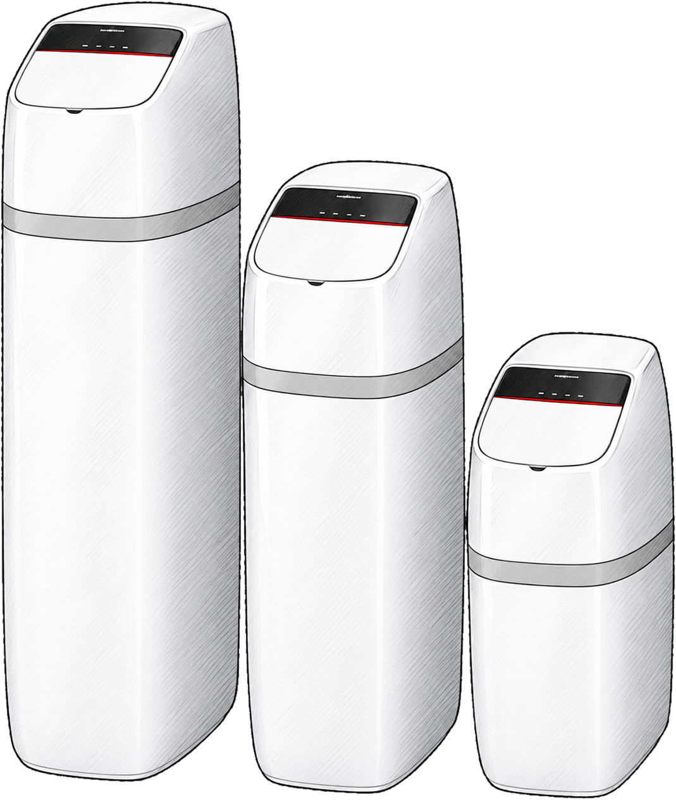

# Viessmann Vitoset Aqua for Home Assistant

Brings the Viessmann Vitoset Aqua water softener into Home Assistant through
the ViCare cloud API. It shows up in the ViCare app, but Home Assistant's own
[ViCare integration](https://www.home-assistant.io/integrations/vicare/) doesn't
support it yet ([core#190448](https://github.com/home-assistant/core/issues/190448)).
Both integrations can run side by side. Once core supports the softener, this
one can go.

Tested on a `VitosetAqua87S`. Requires Home Assistant 2026.10 or newer.

This is a community project, not affiliated with or endorsed by Viessmann.

## Entities

| Entity | Notes |
| --- | --- |
| Salt days remaining | |
| Water consumption total | Use this one in the Energy dashboard |
| Water consumption today, last 7 days | Don't add these to the Energy dashboard, they'd double count |
| Water flow | Refreshed every 5 minutes, so a snapshot and not a live reading |
| Shutoff valve position | |
| Holiday mode | |
| Leak sensor | One per paired sensor, named as in the ViCare app, plus battery and signal strength (off by default). Unknown while a sensor is disconnected. Reload the integration after pairing a new sensor or renaming one |
| Low salt alert threshold, maximum water flow, shutoff valve motor | Diagnostic |

Everything is read-only: the API offers no commands for this device, so the
valve can't be operated from Home Assistant.

## Installation

### HACS (recommended)

Viessmann Vitoset Aqua is available in the default HACS store.

1. Open HACS in Home Assistant (or use the button above).
2. Search for **Viessmann Vitoset Aqua** and download it.
3. Restart Home Assistant.

### HACS custom repository

If it doesn't show up in your HACS store, add it as a custom repository:

1. Open HACS in Home Assistant.
2. Open the menu (⋮) → **Custom repositories**.
3. Add `https://github.com/marcelhoffs/ha-viessmann-vitoset-aqua` with category
   **Integration**.
4. Search for **Viessmann Vitoset Aqua** and download it, then restart Home
   Assistant.

## Setup

1. Create an API client at the
   [Viessmann developer portal](https://app.developer.viessmann-climatesolutions.com)
   with redirect URI `https://my.home-assistant.io/redirect/oauth`. If you already
   have a client for the ViCare integration you can reuse it, but they then
   share the same API quota.
2. Add the integration under Settings → Devices & Services. Enter the client ID;
   the client secret is ignored, so enter any value. Log in with your Viessmann
   account.

## Development

    python -m venv .venv
    .venv/bin/pip install -r requirements_test.txt
    .venv/bin/pytest
